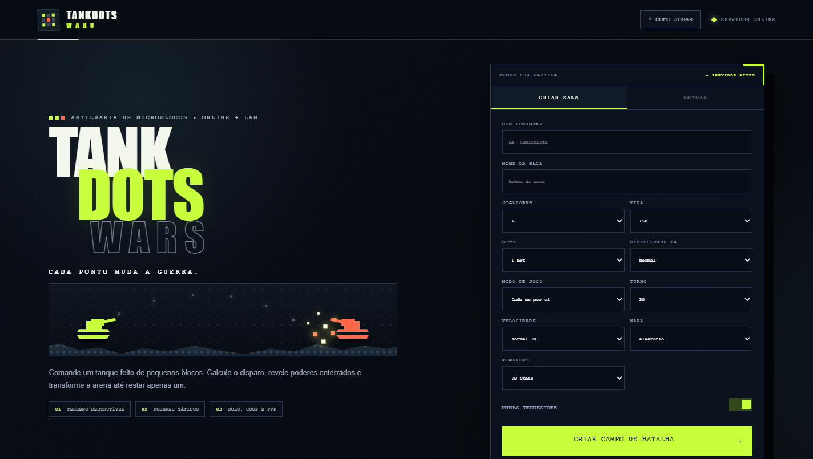
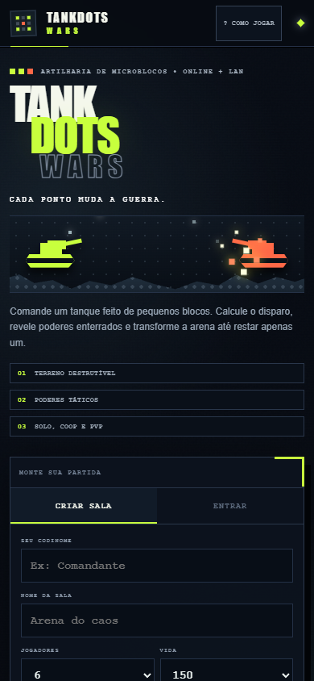
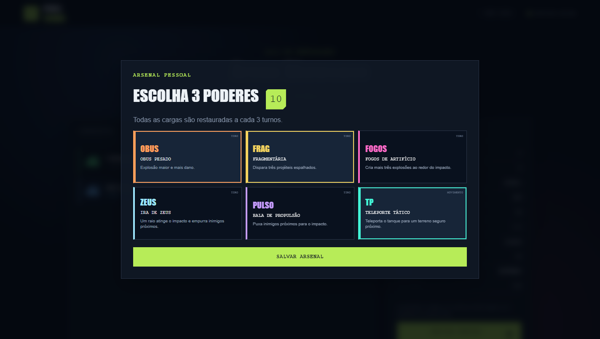
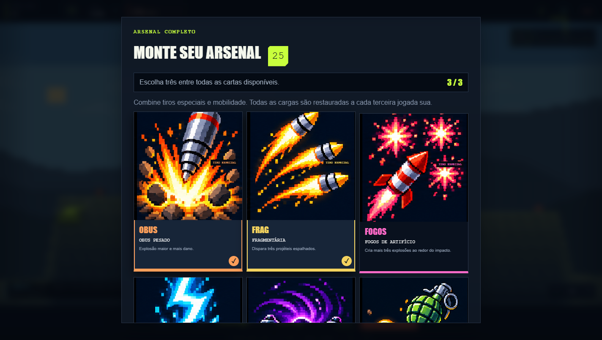
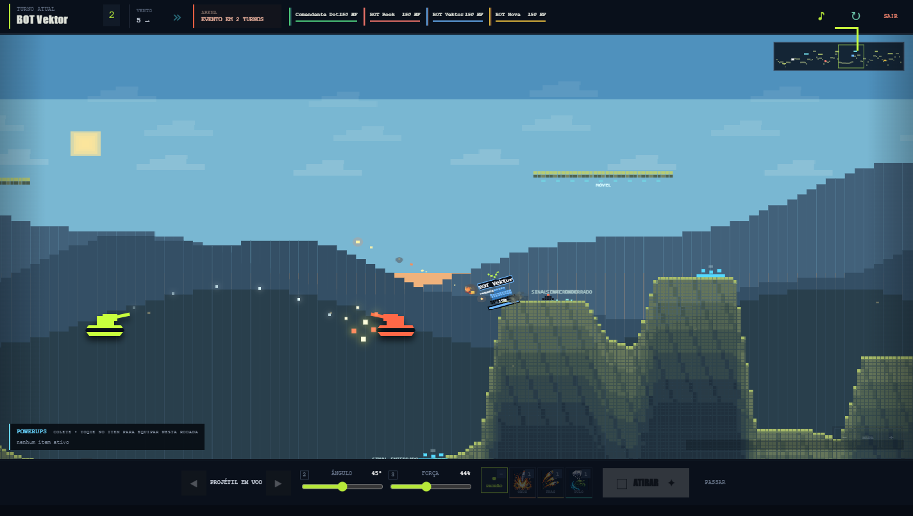
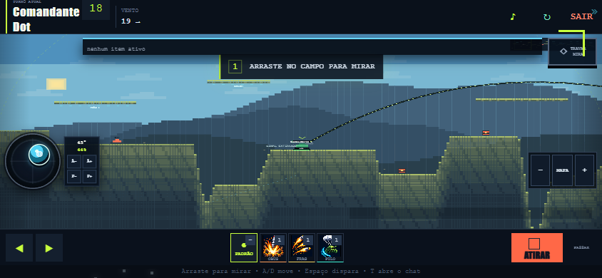
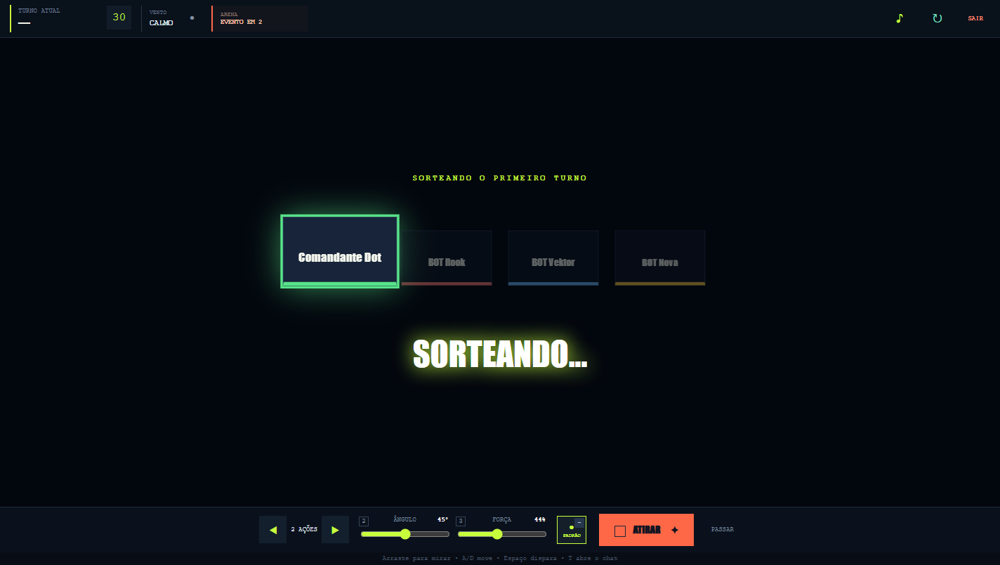
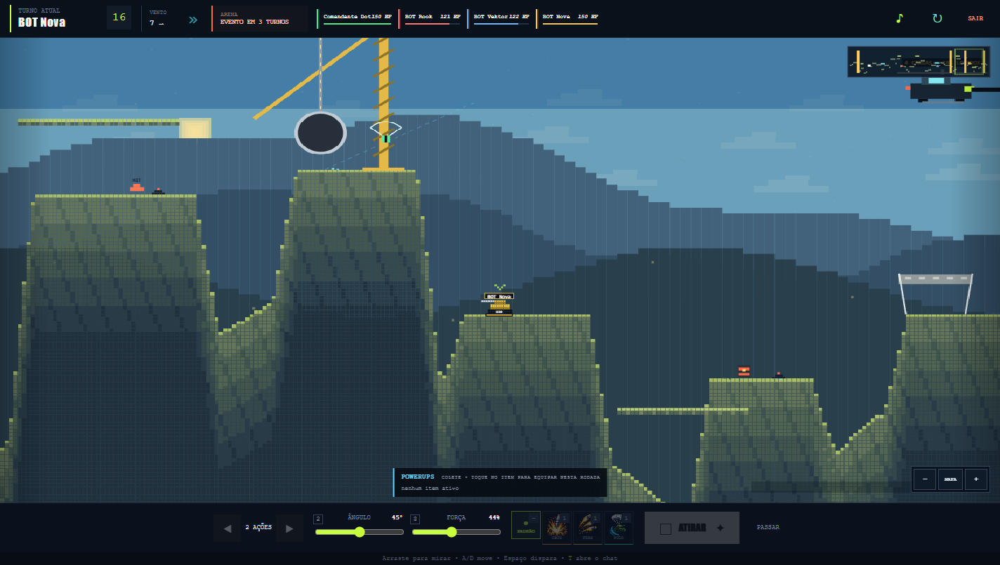
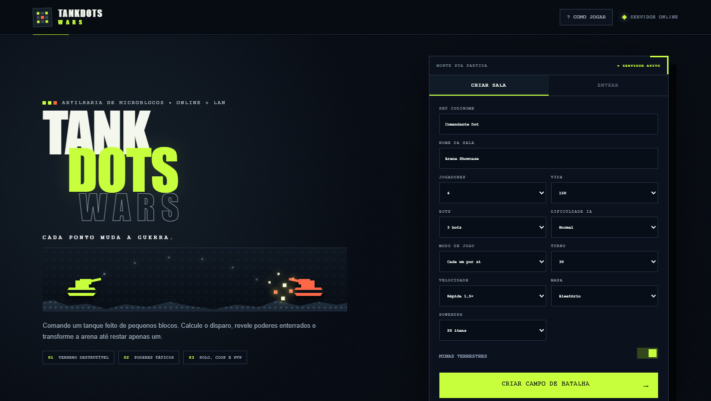

# TankDots Wars

> Artilharia multiplayer por turnos em um mundo de microblocos totalmente destrutível.





Direção de arte e padrão para novas cartas: [docs/ART_DIRECTION.md](docs/ART_DIRECTION.md).

Plano de evolução em 12 blocos: [docs/IMPLEMENTATION_PLAN.md](docs/IMPLEMENTATION_PLAN.md).

TankDots Wars é um jogo de estratégia e artilharia para navegador, feito para partidas locais ou em LAN. Cada disparo altera o campo de batalha: abre crateras, revela itens, ativa objetos e pode derrubar tanques no vazio. Não há instalação no cliente — basta abrir o endereço do servidor no navegador.

## Destaques

- Multiplayer em tempo real via WebSocket, com salas privadas por código.
- Contas opcionais com histórico de partidas, taxa de vitórias, uso de classes e cartas, 16 métricas de combate e medalhas em três níveis.
- Cenário de microblocos destrutível e mapas gerados proceduralmente.
- Seis biomas com paletas próprias, estruturas características e eventos de assinatura: Cidade, Vulcão, Geleira, Usina, Cânion e Base Aérea.
- Partidas para até 10 jogadores, com bots em três dificuldades.
- Partida teste guiada em um clique: duelo contra bot fácil, arsenal inicial pronto e oito etapas de tutorial dentro da arena. Use `?` para reabrir as instruções.
- Turnos com vento, gravidade, mira, força e diferentes tipos de munição.
- Prévia de caminhada e movimentos especiais, compartilhando a mesma regra de colisão do servidor.
- Arsenal pessoal: cada jogador escolhe três poderes antes da batalha e pode encontrar novas habilidades no mapa.
- Fogos de Artifício, Ira de Zeus, Bala de Propulsão e Teleporte Tático.
- Cargas do Arsenal recarregadas individualmente em 2 a 4 turnos próprios, conforme a arma.
- Power-ups e habilidades do Arsenal surgem enterrados, com inventário acumulável e escolha de recompensa.
- Power-ups coletados pelo tanque, pela trajetória do projétil ou pela explosão.
- Eventos para partidas longas: bombardeios, raios, erupções, vendavais, suprimentos e alterações do cenário.
- Chat dentro da partida, reconexão e substituição por bot ao abandonar.
- Velocidade configurável de `0,75×` a `2×`.
- Interface responsiva para desktop e dispositivos móveis.
- Modos **Cada um por si**, **Coop**, **VS Equipes**, **Rei da Colina**, **Sobrevivência** e **Domínio por Equipes**.

## Partida teste guiada

Para testar rapidamente, clique em **PARTIDA TESTE GUIADA** na tela inicial. O jogo cria uma sala com um bot fácil, salta a montagem do arsenal e abre um guia dentro do campo. Avance as etapas com **PRÓXIMO**; o botão **?** mantém o guia disponível durante a partida. O treino explica movimento, mira e força, cartas do arsenal, tiros, coleta/combos de powerups, eventos, estruturas de cura e vitória.

## Modo TESTE

Na tela inicial, digite **T E S T** no teclado, fora dos campos de texto. Uma partida de teste com um bot começa automaticamente. Abra **⚙ TESTE** no HUD para trocar de classe, escolher qualquer arma selecionável, adicionar powerups, recarregar vida, combustível e munição, mudar o cenário e ajustar a classe, vida, dificuldade e comportamento do bot. O bot começa parado e passa a vez sozinho; selecione **Combate ativo** para testar a IA. O cenário aquático permite experimentar o Anfíbio e as armas submersas. **REINICIAR TESTE** recomeça preservando as configurações escolhidas. O modo TESTE não altera as regras das salas normais.

## Arsenal pessoal





Cada comandante escolhe exatamente três itens no saguão. Cada habilidade tem recarga própria de 2 a 4 turnos do jogador, indicada na carta e no HUD. Habilidades do Arsenal também podem aparecer como cápsulas enterradas: coletá-las adiciona uma carga e inclui temporariamente a habilidade no Arsenal daquela partida.

| Poder | Categoria | Efeito |
| --- | --- | --- |
| Obus Pesado | Tiro | Grande explosão e dano elevado. |
| Fragmentária | Tiro | Lança três projéteis espalhados. |
| Fogos de Artifício | Tiro | Produz doze microexplosões que escavam o solo ao redor do impacto. |
| Ira de Zeus | Tiro | Invoca um raio e empurra fortemente os inimigos próximos. |
| Bala de Propulsão | Tiro | Puxa tanques próximos para o centro do impacto. |
| Teleporte Tático | Movimento | Transporta o tanque para um terreno seguro próximo. |

## A batalha





Antes do primeiro disparo, uma roleta animada sorteia de forma sincronizada quem começa a partida.



O terreno muda continuamente. Explosões removem blocos, plataformas podem quebrar, minas reagem em cadeia e cápsulas enterradas são reveladas pelas crateras. Minas nativas causam 70 HP (minas arremessadas causam 40 HP). A cada terceira jogada própria, o jogador recebe três power-ups aleatórios para escolher um; a recarga do Arsenal ocorre separadamente, conforme cada carta.

O Caça Voadora é uma carta selecionável do Arsenal. A Haste é exclusiva do Meteorologista: não aparece na escolha inicial e entra automaticamente em seu Arsenal na rodada 2. Ela aceita combos com modificadores de tiro, como Tiro Duplo, Expansor de Impacto, Congelamento e Mega Bomba.
O pulso elétrico da Haste causa 10 HP por turno. O Sabotador emite um pulso magnético de 760 blocos a cada três rodadas, com onda visível; inimigos afetados perdem o uso de powerups no turno seguinte.



Quando uma partida se prolonga, a arena acelera o confronto com eventos especiais:

- **Suprimentos aéreos:** um helicóptero cruza o cenário e solta power-ups visíveis em posições aleatórias. Cada voo tem 18% de chance de incluir uma Lootbox com três aprimoramentos diferentes;
- **Bombardeio progressivo:** miras antecipam os pontos de queda e uma sequência de projéteis verticais produz explosões cada vez maiores (24 a 59 HP antes da escalada por rodadas);
- **Tempestade elétrica:** raios causam explosões e deixam os tanques próximos sem poder usar power-ups durante um turno;
- **Evento tectônico:** o terremoto eleva e afunda grandes trechos, deslocando levemente os tanques e podendo derrubá-los em buracos;
- **Ventos de Sorte:** grandes auras douradas recuperam 40 HP dos tanques em seu interior;
- **Colapso:** partes instáveis do cenário são destruídas.

## Saguão e configuração



O anfitrião pode configurar modo de jogo, número máximo de jogadores, bots, dificuldade da IA, vida inicial, duração dos turnos, velocidade, mapa, quantidade de power-ups e minas terrestres. No modo Coop, humanos formam uma equipe contra os bots, sem dano aliado; a partida termina quando uma equipe é eliminada. Cada jogador configura seu próprio Arsenal antes do início.

Em **Sobrevivência**, a lava sobe a cada rodada e elimina tanques submersos; o HUD mostra o próximo nível previsto. Em **Domínio por Equipes**, aliados capturam juntos a colina se não houver adversário na zona. A primeira equipe com quatro pontos vence, assim como a última equipe sobrevivente.

O estado dos 12 blocos de evolução está no [plano](docs/IMPLEMENTATION_PLAN.md). A [lista de QA](docs/QA_HANDOFF.md) separa o que foi verificado no navegador do que ainda depende de iPhone e Android físicos.

## Publicar online no Render

O repositório inclui `render.yaml`, configurado como um Web Service Node com health check em `/health`.

1. Envie a versão atual para o GitHub.
2. No Render, escolha **New + → Blueprint**.
3. Conecte o repositório `SeuCarlin/Pixel_Tanks`.
4. Confirme a criação do serviço `tankdots-wars`.
5. Ao terminar o deploy, compartilhe a URL `https://tankdots-wars-....onrender.com`.

O navegador troca automaticamente de `ws://` para `wss://` quando o site usa HTTPS. Jogadores entram normalmente por código; espectadores informam o mesmo código e usam **Assistir como espectador**. Espectadores não ocupam vagas, podem entrar durante uma partida e participam do chat.

As salas estão em memória. Portanto, mantenha somente uma instância do serviço: reinícios e novos deploys encerram partidas ativas. Para operação contínua, use um plano sem suspensão automática; persistência e múltiplas instâncias exigirão mover o estado das salas para Redis/Key Value.

### Contas e estatísticas

O botão **Criar conta / Entrar** fica no topo do jogo. As contas são opcionais; partidas concluídas com uma conta vinculada salvam minutos em combate, vitórias, classes, arsenal, powerups e medalhas. É possível criar uma conta ao fim da partida para associar aquele resultado. Partidas de tutorial e do modo TESTE não alteram as estatísticas.

O servidor salva os dados em `data/accounts.json` (ou no diretório definido por `TANKDOTS_DATA_DIR`). A pasta não entra no Git e deve ter backup. Em hospedagem com disco temporário, configure `TANKDOTS_DATA_DIR` num volume persistente: sem isso, contas e estatísticas desaparecem após reinícios ou deploys. O serviço deve usar uma única instância enquanto a persistência for por arquivo.

## Como executar

### Pacote portátil para Windows

1. Execute `INICIAR_JOGO.bat`.
2. Aguarde o navegador abrir `http://localhost:3000`.
3. Para jogar em LAN, compartilhe o endereço exibido no terminal com os outros jogadores.

Uma distribuição portátil pode incluir `node.exe` e dispensar a instalação global. No código-fonte do GitHub, instale Node.js 20+; o inicializador detecta automaticamente a instalação do sistema.

### Instalador Windows com anfitrião local

Execute `TankDotsWars-Setup.exe` da pasta `release`. Ele instala o jogo e o servidor Node incluído em `%LOCALAPPDATA%\TankDots Wars`, cria atalhos e registra a desinstalação para o usuário atual. O atalho **Hospedar TankDots Wars** inicia o servidor, espera a resposta de `/health` e abre o navegador. O anfitrião cria uma sala e também joga nela; os convidados não precisam instalar nada.

Na mesma rede, **Convidar amigos** oferece o IP local do anfitrião no lugar de `localhost`. Em redes diferentes, os jogadores precisam alcançar o PC do anfitrião por VPN ou por encaminhamento da porta TCP anunciada no terminal. O instalador pode salvar um endereço público/VPN para usar nos convites, mas isso não configura roteador nem firewall. Para usar HTTPS, o proxy ou túnel precisa encaminhar WebSockets.

Para reconstruir o instalador no Windows, com o pacote portátil em `release/TankBattle-Portable-Windows`, execute `powershell -ExecutionPolicy Bypass -File packaging/windows/build-installer.ps1` na pasta `_upstream`. A compilação usa o compilador C# do .NET Framework presente no Windows e testa a extração antes de entregar o EXE.

### Desenvolvimento

Requer Node.js 20 ou superior.

```bash
npm install
npm start
```

Para reiniciar automaticamente após alterações no servidor:

```bash
npm run dev
```

## Controles

| Ação | Controle |
| --- | --- |
| Mover | `A` / `D`, setas ou botões na tela |
| Mirar | Arrastar no campo ou usar os controles de ângulo e força |
| Travar mira no celular | Botão **TRAVAR MIRA** congela direção, ângulo e força |
| Disparar | `Espaço` ou botão **Atirar** |
| Abrir o chat | `T` |
| Enviar mensagem | `Enter` |
| Fechar o chat | `Esc` |
| Zoom | Roda do mouse |
| Teleporte Tático | Selecionar `TP` e tocar no destino |
| Reiniciar partida | Botão `↻` do anfitrião durante a partida |

## Estrutura

```text
client/             Interface, áudio e renderização Canvas
server/             Salas, física, terreno e servidor WebSocket
shared/             Constantes e protocolo compartilhado
scripts/            Ferramentas de desenvolvimento
test/               Testes automatizados
docs/screenshots/   Capturas usadas na documentação
```

O servidor usa Express e `ws`. A renderização é feita diretamente em Canvas 2D, sem frameworks de interface ou assets externos obrigatórios.

## Testes

```bash
npm test
```

A suíte cobre configuração e recarga do Arsenal, recompensas periódicas, velocidade da partida, coleta de power-ups pela trajetória e efeitos especiais.

## Atualizar screenshots

Com o servidor rodando na porta `3012`:

```powershell
$env:TANKDOTS_WARS_URL='http://localhost:3012'
node scripts/capture-screenshots.mjs
```

O script usa o Google Chrome instalado no Windows e recria as imagens de documentação em desktop e mobile.

## Tecnologias

- JavaScript com ES Modules
- Node.js
- Express 5
- WebSocket (`ws`)
- Canvas 2D
- CSS responsivo
- Node Test Runner

## Licença

Distribuído sob a licença MIT. Consulte [LICENSE](LICENSE).

